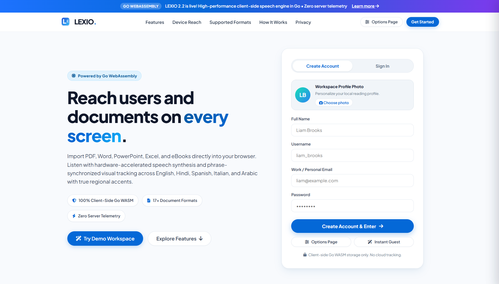
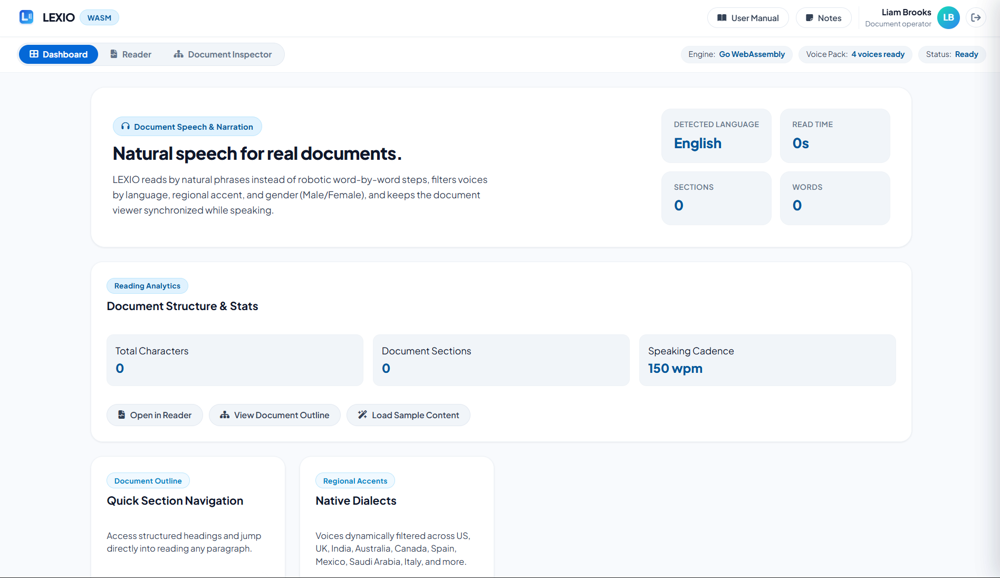
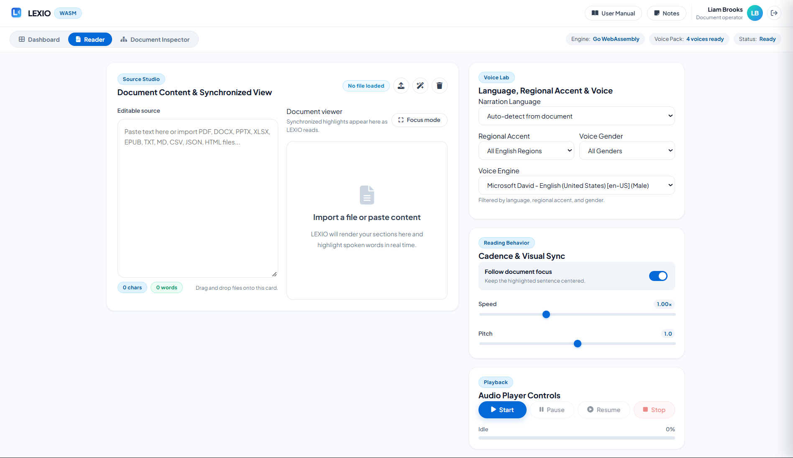
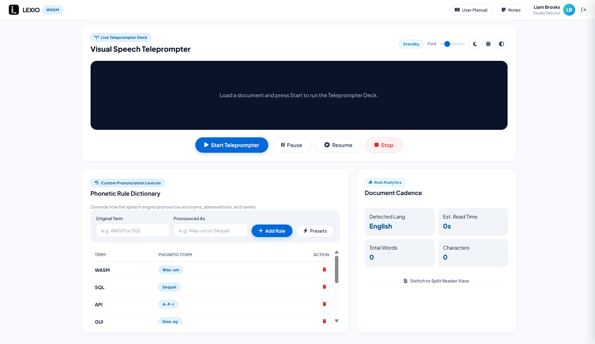

<p align="center">
  
</p>
<h1 align="center">LEXIO</h1>
<p align="center">
  <strong>Client-Side Document Speech Studio powered by Go WebAssembly</strong>
</p>
<p align="center">
  <a href="https://voxion-labs.github.io/LEXIO/"><strong>Live Application</strong></a>
  &nbsp;|&nbsp;
  <a href="https://github.com/Voxion-Labs/LEXIO"><strong>GitHub Repository</strong></a>
</p>

---

## Technical Overview

**LEXIO** is a browser-native document speech synthesis and narration workstation built entirely in **Go WebAssembly** and standard Web APIs. It eliminates backend infrastructure and server roundtrips, executing all document ingestion, phrase segmentation, speech synthesis orchestration, and computational cadence telemetry directly on the client machine.

Designed with Flutter and Material 3 design ergonomics, LEXIO operates seamlessly across desktops, tablets, and mobile devices without requiring Node.js runtimes, cloud backend endpoints, or user telemetry collection.

---

## Architectural Principles

1. **Go WebAssembly Engine (`GOOS=js GOARCH=wasm`)**  
   Core application state, document structure segmentation, phonetic pronunciation substitutions, and linguistic telemetry algorithms are compiled into a standalone WebAssembly binary (`wasm/app.wasm`), running client-side with native execution speed.

2. **100% Client-Side Privacy (Zero Server Telemetry)**  
   No text or binary documents are uploaded over the network. Documents imported from PDF, DOCX, XLSX, PPTX, or EPUB are parsed locally into browser memory. Profiles, pronunciation dictionaries, and workspace notes persist exclusively in the browser's private `localStorage`.

3. **Regional Dialect & Gender Matching**  
   Interfaces directly with the browser's native **Web Speech API** to filter and allocate synthesized voices across English, Spanish, Italian, Arabic, and Hindi with regional accent specificity (e.g. US, UK, India, Australia, Spain, Mexico, Saudi Arabia, Italy) and explicit gender filtering (Male / Female).

4. **Synchronized Phrase & Word Tracking**  
   Audio synthesis triggers real-time boundary events mapped to interactive DOM nodes, automatically highlighting and centering the active phrase as it is spoken.

---

## Workspace Screenshot Gallery

<table>
  <tr>
    <td width="50%" valign="top">
      
      <br />
      <strong>1. Workspace Profile &amp; Authentication</strong>
      <br />
      <em>Scrollable Flutter-inspired onboarding with local account creation, custom avatar upload, and immediate guest demo access.</em>
    </td>
    <td width="50%" valign="top">
      
      <br />
      <strong>2. Document Speech Dashboard</strong>
      <br />
      <em>Centralized hub displaying detected language, reading duration, section metrics, outline navigation, and native dialect distribution.</em>
    </td>
  </tr>
  <tr>
    <td width="50%" valign="top">
      
      <br />
      <strong>3. Reader &amp; Synchronized Narration</strong>
      <br />
      <em>Dual-column workspace featuring editable source ingestion, synchronized reading surface, voice tuning lab, and focus mode.</em>
    </td>
    <td width="50%" valign="top">
      
      <br />
      <strong>4. Teleprompter &amp; Telemetry Studio</strong>
      <br />
      <em>Full-screen teleprompter stage with karaoke tracking, phonetic pronunciation lexicon, and computational cadence analysis.</em>
    </td>
  </tr>
</table>

---

## Core Workspaces

### 1. Dashboard (`dashboardView`)
- **Real-Time Document Telemetry**: Displays total character count, word count, structural sections, and estimated listening duration.
- **Interactive Outline**: Automatically parses document headings and topics into jump-navigation links.
- **Dialect Coverage**: Lists available system voices filtered across supported regional locales.
- **Quick Actions**: One-click shortcuts to launch Reader, open Teleprompter Studio, or load structured test content.

### 2. Multi-Format Reader (`readerView`)
- **Universal Ingestion**: Drag-and-drop or file upload supporting **PDF, DOCX, DOC, PPTX, PPT, XLSX, EPUB, TXT, MD, CSV, JSON, RTF, HTML, XML, ODT, and ODP**.
- **Interactive Word Mapping**: Spoken sentences and individual words are rendered as interactive nodes. Clicking any word immediately re-routes speech playback to begin at that exact position.
- **Voice Lab**: Dropdown filtering by language, regional dialect, voice gender, playback rate ($0.5\times$ to $2.0\times$), and audio pitch.
- **Visual Sync**: Smooth auto-centering that keeps the spoken line in the viewport during long document playback.

### 3. Studio & Telemetry (`studioView`)
- **Live Visual Teleprompter**: High-visibility stage designed for speech delivery, video recording, and rehearsal. Includes live word tracking, dynamic font scaling ($20\text{px}$ to $52\text{px}$), and theme options (Dark Studio, Paper Light, Neon High-Contrast).
- **Custom Pronunciation Lexicon**: Phonetic dictionary allowing users to override TTS pronunciation for technical acronyms, abbreviations, and foreign terms (e.g. `WASM` &rarr; `Waz-um`, `SQL` &rarr; `Sequel`, `LaTeX` &rarr; `Lay-tek`) via live regex evaluation in Go.
- **Computational Readability Metrics**:
  - **Flesch Reading Ease**: Mathematically evaluates sentence length and syllable density on a 0–100 scale.
  - **Gunning Fog Index**: Computes estimated US school grade reading level based on complex polysyllabic words.
  - **Cadence Time Analysis**: Compares speaking duration across Presentation pace ($125\text{ WPM}$), Conversational pace ($150\text{ WPM}$), and Quick Skim ($180\text{ WPM}$).
- **Subtitle & Caption Exporter**: Generates and downloads valid `.srt` (SubRip) and `.vtt` (WebVTT) subtitle files with calculated sentence durations for video editing in Premiere Pro, DaVinci Resolve, CapCut, or YouTube.

---

## Repository Structure

```text
LEXIO/
├── .nojekyll                 # Prevents GitHub Pages Jekyll build conflicts with WASM
├── assets/
│   ├── logo.svg              # Vector brand mark with black background
│   └── logo.png              # Raster 512x512 app icon
├── css/
│   └── components.css        # Flutter / Material 3 styling tokens & components
├── docs/
│   ├── API.md
│   ├── CHANGELOG.md
│   └── readme/               # Documentation screenshots
│       ├── lexio-auth-workspace.png
│       ├── lexio-dashboard.png
│       ├── lexio-reader.png
│       └── lexio-teleprompter-studio.png
├── src/                      # Go WebAssembly source code
│   ├── main.go               # WASM initialization & runtime loop
│   ├── auth.go               # Client-side user account & profile state
│   ├── document.go           # File ingestion, text cleaner & section parser
│   ├── speech.go             # Web Speech API bridge & voice filters
│   ├── director.go           # Teleprompter, pronunciation lexicon, readability & subtitles
│   └── ui.go                 # Tab router, drawer panels & toast manager
├── wasm/
│   ├── app.wasm              # Compiled WebAssembly binary
│   └── wasm_exec.js          # Official Go WASM JavaScript bridge
├── index.html                # Single-page application entrypoint
├── styles.css                # Application stylesheets
└── README.md
```

---

## Building and Local Development

### Prerequisites
- [Go 1.22+](https://go.dev/dl/) installed.
- Modern web browser with WebAssembly and Web Speech API support (Chrome, Edge, Firefox, Safari).

### Compile Go WebAssembly
To compile the Go source files from the `src/` directory into `wasm/app.wasm`:

```powershell
# Windows (PowerShell)
$env:GOOS="js"; $env:GOARCH="wasm"; go build -o wasm/app.wasm ./src
```

```bash
# macOS / Linux
GOOS=js GOARCH=wasm go build -o wasm/app.wasm ./src
```

### Run Locally
Serve the repository root using any standard static file server:

```bash
# Python 3
python -m http.server 8080

# Node.js
npx serve .
```

Open `http://localhost:8080` in your web browser.

---

## Deployment Profile

- **Target**: GitHub Pages (Static hosting).
- **Domain**: [https://voxion-labs.github.io/LEXIO/](https://voxion-labs.github.io/LEXIO/)
- **Configuration**: Uses `.nojekyll` to bypass Jekyll compilation and serve `.wasm` binaries directly.

---

## License

LEXIO operates under a custom restricted proprietary license.

The full license text is available in the [LICENSE](LICENSE) directive.

License summary:

- copyright © 2026 Rudranarayan Jena
- all rights reserved
- unauthorized copying, modification, distribution, hosting, reuse, or derivative work creation is strictly prohibited
- commercial or non-commercial exploitation is forbidden unless explicitly authorized in writing by the architect
- LEXIO is **not** an open-source project and is not distributed under MIT, Apache, GPL, or any other permissive license.
---

<br>
<div align="right">
  <b>Rudranarayan Jena</b><br>
  <i>Founder @ Voxion Labs</i>
</div>

---
<div align="center">
  (c) 2026 Voxion Labs & Rudranarayan Jena
</div>
